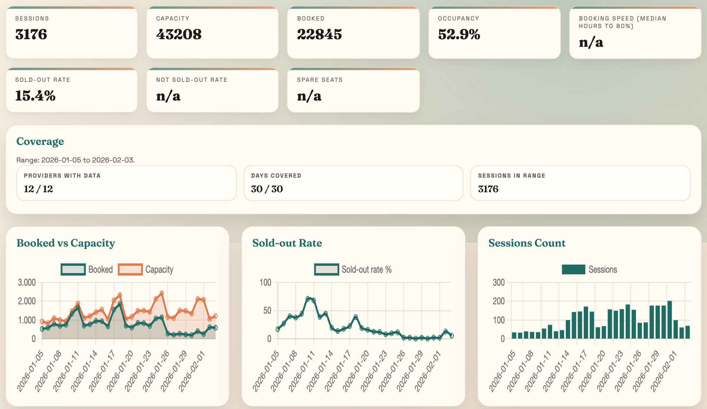
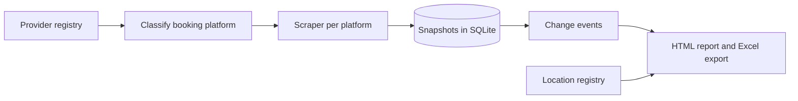

# Sauna Market Intelligence

Sizing a market from public booking data instead of guessing: a pipeline that records how sauna sessions fill up, hour by hour, across providers.

> **This is a case study with selected source files.** The full scrapers and the dataset are private. The database schema, the change detection and the workflow runner are in [`code/`](code/).

| At a glance | |
|---|---|
| **Type** | Personal project, built alone |
| **Period** | December 2025 to February 2026, collection restarted October 2026 |
| **Status** | Collecting hourly again since October 2026, after a silent stop described under limits. The pipeline and report work end to end. |
| **Stack** | Python, SQLite, scheduled jobs on macOS, HTML report |

## The question

I was considering starting a sauna business. Before spending money, I wanted to know how full the existing providers actually are, when, and at what price.

I have since put the business idea on hold. I was not sure it was something I wanted to commit to fully, and I lacked the capital. The data collection continues, so the question can be answered on better evidence if I return to it.

## Why it matters

The usual way to size a small local market is to count competitors and guess the rest. Here there was a better option. Most providers sell sessions through public booking pages, so capacity and remaining places are visible to anyone, session by session. Recorded repeatedly, that turns into a picture of supply and demand that no desk research gives.

## What I built

A pipeline that finds the providers, reads their public booking data on a schedule, stores every observation, and turns the result into a report.



*Overview tab of the report from February 2026, 30-day view across all twelve providers. Collection had stopped on 22 January, so for later dates the chart shows bookings as they stood on that day, not final attendance.*

What was collected in the first period:

| Measure | Value |
|---|---|
| Providers identified in the market | 148 |
| Providers with booking data collected | 12, across 26 locations |
| Collection period | 30 December 2025 to 22 January 2026 |
| Session snapshots | 1,331,097 |
| Distinct sessions | 7,919 |
| Change events derived from the snapshots | 16,380 |

## My role

My own question and my own project. I worked out what the data had to answer, found where it could be read, and decided what to store and at what level of detail. The scrapers and the report were written by AI coding agents from task descriptions I wrote. The pipeline writes its own review files, such as link checks and location coverage, and those are what I used to judge data quality.

The project is organised in three layers, a pattern I have reused in later projects: a written **directive** for each task (goal, inputs, outputs, edge cases), an **orchestration** script that runs the steps in order, and **execution** scripts that do the actual work.

## How it works



- **Provider registry.** A list of providers with their booking links. Links are discovered, verified, and recovered when they break.
- **Platform classification.** Each provider is tagged with the booking platform it uses, because each platform needs its own scraper. Five platforms are covered so far.
- **Scheduled snapshots.** For every session: time, place, capacity, booked count and remaining places.
- **Change events.** Differences between two snapshots of the same session are stored as events.
- **Report.** One command runs the whole chain and writes an HTML report with filters for provider, area and period.

Only public booking pages are read. Nothing requires a login, and no customer data is collected.

## Key decisions

**Store raw snapshots, derive the rest.** Every observation is kept as it was read, and events are computed from them afterwards. That is what makes it possible to ask how fast sessions fill, as a booking curve, and not only how full they end up. A new question can be answered from data already collected.

**A registry makes it extendable.** Adding a provider on a platform that is already supported is a line of data and no new code. That is why the registry and the classification step exist as their own parts.

**Link maintenance is a tool of its own.** Booking links change. Verifying and recovering them became separate scripts that write a review file, so a broken link shows up as a line to look at and not as silently missing data.

## Selected implementation

How a booking change is detected. Each new snapshot is compared with the previous one for the same session, and only a difference is stored. The change in booked places is what later becomes a booking curve.

```python
prev_booked = normalize_int(prev_snapshot["booked_count"]) if prev_snapshot else None
curr_booked = normalize_int(snapshot.get("booked_count"))
if curr_booked is not None:
    if is_new or prev_booked is None or prev_booked != curr_booked:
        delta = None if prev_booked is None else curr_booked - prev_booked
        changes["booked"] = {
            "from": prev_booked,
            "to": curr_booked,
            "delta": delta if delta is not None else curr_booked,
        }
```

The same comparison runs for capacity, sold-out and waiting-list status, and for changes to time, place and title. The functions are in [`code/change_detection.py`](code/change_detection.py), the tables in [`code/schema.sql`](code/schema.sql), and the script that runs the whole chain in [`code/run_market_analysis.py`](code/run_market_analysis.py).

## Limits I would state up front

- **Coverage.** Booking data comes from 12 of the 148 providers identified. It describes those providers and not the whole market.
- **A silent stop.** In February I reorganised the project folders. The scheduled job still pointed at the old path, failed every half hour, and nothing told me. I believed it was collecting until October 2026. The schedule is repaired and one failing provider no longer stops the others, but about eight months of data are missing.
- **Gaps.** The schedule runs on my own computer, so there are hours without data whenever it is off.
- **Providers change platform.** When collection restarted, two of the largest providers had moved to other booking systems, and a third no longer sells sessions online. Each move needed a new scraper. Their history continues under the same provider name.
- **Three weeks is short.** It covers one winter period and says nothing about seasons.
- **Bookings are not attendance.** A booked place can still be a no-show.

## What I learned

- Keep the raw observations. Questions change, and raw data can answer the new ones.
- A collector needs something that tells you when it has stopped. Mine did not, and that cost more data than any bug in the scraper.
- Decide early what a number may be used for. A dashboard looks equally confident whether the data behind it is three weeks or three years.

---

© Oliver Bruhn. Text, images and code may not be reused without permission.
